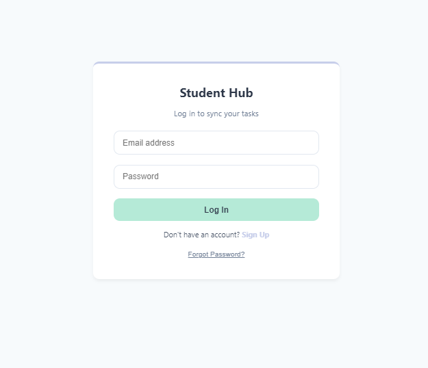
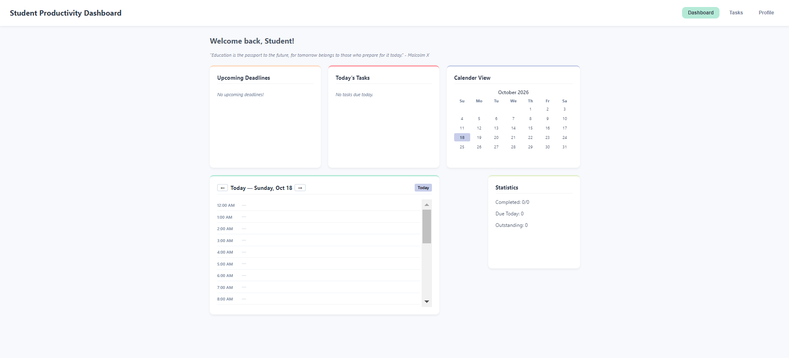
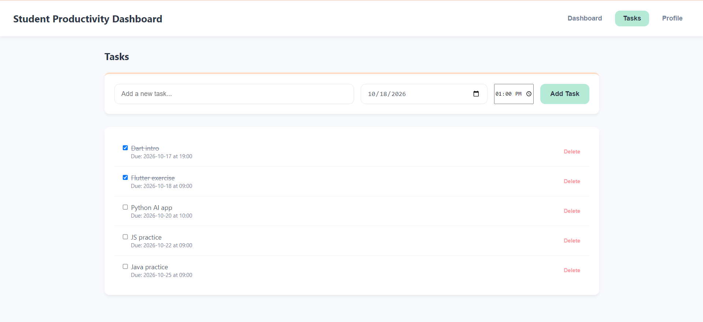
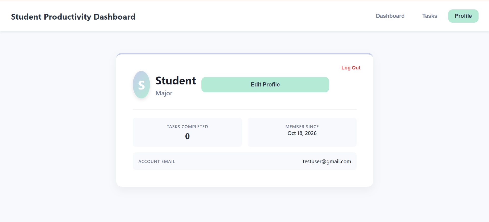

# 🎓 Student Productivity Dashboard (SPA)

A lightweight, responsive Single Page Application (SPA) designed to help students master their schedules, manage tasks, track deadlines, and monitor study statistics in real time. Built with a soothing pastel theme and powered by Firebase v10+ for secure authentication and cloud data persistence.


## 🔗 Live Demo

Experience the live, interactive app without any local setup:

👉 **[Launch Student Productivity Dashboard](https://prozuhur96.github.io/Student-Productivity-Dashboard/)**

---


## 📑 Table of Contents

- [🔗 Live Demo](#-live-demo)
- [📸 Interface Screenshots](#-interface-screenshots)
- [✨ Features](#-features)
- [🛠️ Tech Stack](#-tech-stack)
- [📁 Project Structure](#-project-structure)
- [🚀 Setup & Installation](#-setup--installation)
- [🔮 Future Roadmap](#-future-roadmap)
- [🤝 Contributing & Feedback](#-contributing--feedback)
- [📝 Author](#-author)

---


## 📸 Interface Screenshots

### 1. Authentication & Cloud Sync
> Secure email/password login and registration overlay powered by Firebase Auth.



### 2. Dashboard View
> Central hub displaying the motivational quote, daily schedule timeline, monthly calendar grid, top deadlines, today's tasks, and live productivity stats.



### 3. Task Management
> Add, track, and complete tasks with specific dates and times. Features optimistic UI updates for instant feedback.



### 4. User Profile & Account Metadata
> Customizable user card featuring your name, major, avatar, account creation date, and total task completion statistics.




## ✨ Features

- **Firebase v10+ Integration**: Secure backend authentication (`signInWithEmailAndPassword`, `createUserWithEmailAndPassword`) and real-time Firestore cloud data persistence.
- **Optimistic UI Updates**: Instant local state changes for task completion and management, syncing seamlessly with the cloud in the background.
- **Dynamic Daily Schedule & Deadlines**: Automated tracking for today's tasks and top upcoming deadlines to keep students ahead of their work.
- **Interactive Calendar View**: Clean monthly layout highlighting active dates and schedule flow.
- **Responsive Pastel Theme**: Crafted using CSS custom properties (`:root`), flexbox, and grid for a soothing, distraction-free study environment across both desktop and mobile screens.


## 🛠️ Tech Stack

- **Frontend**: 
  - HTML5 (Semantic structure)
  - CSS3 (Custom Properties / Variables, Grid, Flexbox, Responsive Design)
  - Vanilla JavaScript (ES6+ Modules, Async/Await, DOM Manipulation)
- **Backend & Database**: 
  - Firebase v10+ Authentication (Email/Password login & session management)
  - Firebase Firestore (Real-time cloud database storage)
- **Development & Deployment**: 
  - Git & GitHub (Version control)
  - GitHub Pages (Hosting & deployment)

  ---

## 📁 Project Structure

```text
Student-Productivity-Dashboard/
├── assets/             # UI screenshots and image assets for README.md
├── styles.css          # Custom CSS variables, grid, and layout styles
├── app.js              # Modular JavaScript logic (Auth, Firestore, UI rendering)
├── index.html          # Main SPA entry point
└── README.md           # Project documentation
```

---

## 🚀 Setup & Installation
To run this project locally or configure it for your own use, follow these simple steps:

1. **Clone the repository:**
   ```bash
   git clone [https://github.com/prozuhur96/Student-Productivity-Dashboard.git](https://github.com/prozuhur96/Student-Productivity-Dashboard.git)
   cd Student-Productivity-Dashboard
   ```

2. **Configure Firebase:**
    - Create a project in the Firebase Console.
    - Enable Authentication (Email/Password provider) and Firestore Database.
    - Replace the firebaseConfig object in your project with your unique Firebase project credentials.

3. **Run Locally:**
    - Open the project using a local development server (such as the **Live Server** extension in VS Code) to ensure ES modules (`type="module"`) load correctly without CORS restrictions.


## 🔮 Future Roadmap

- Dark Mode toggle to complement the Pastel theme
- Push notifications / email reminders for approaching project deadlines

---

## 🤝 Contributing & Feedback

Contributions, issues, and feature requests are welcome! Feel free to check out the [issues page](https://github.com/prozuhur96/Student-Productivity-Dashboard/issues) if you want to report a bug or suggest an enhancement.

---

## 📝 Author

Created with ❤️ by **[Zuhur](https://github.com/prozuhur96)**.
